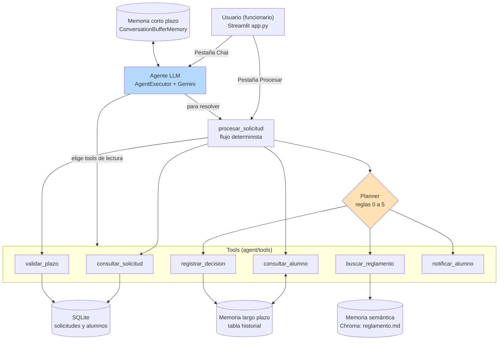
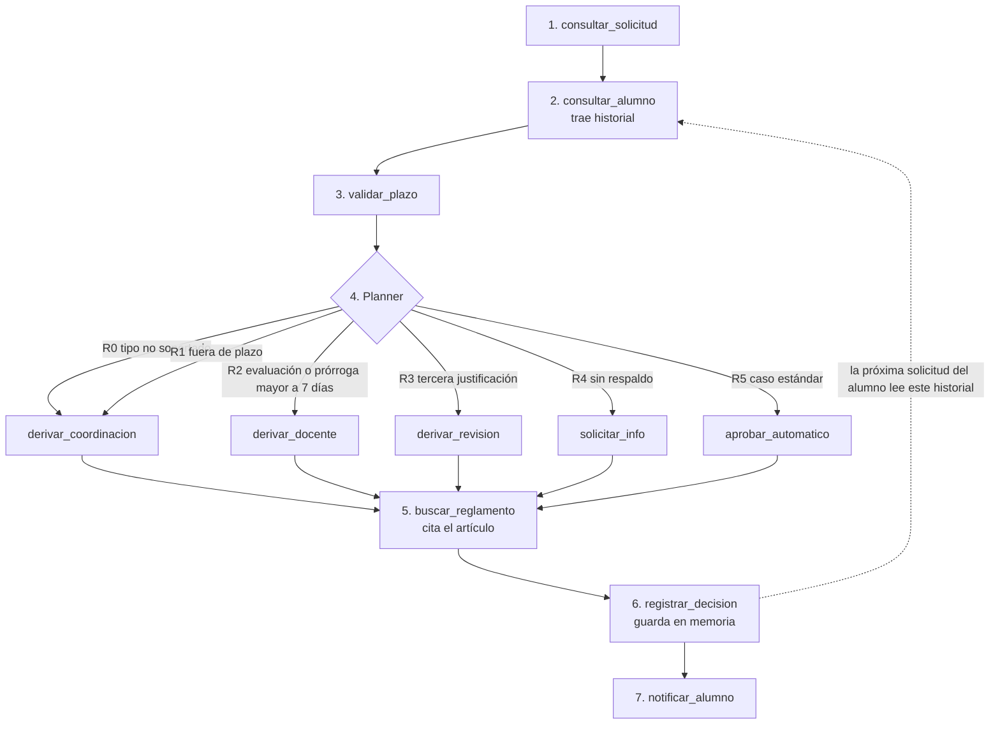

# Diagrama de orquestación del agente

## 1. Componentes y capas

## 2. Flujo de una solicitud (procesar_solicitud)

La flecha punteada es la que muestra la memoria: lo que el agente guarda en
el paso 6 cambia lo que decide la próxima vez (regla 3).
